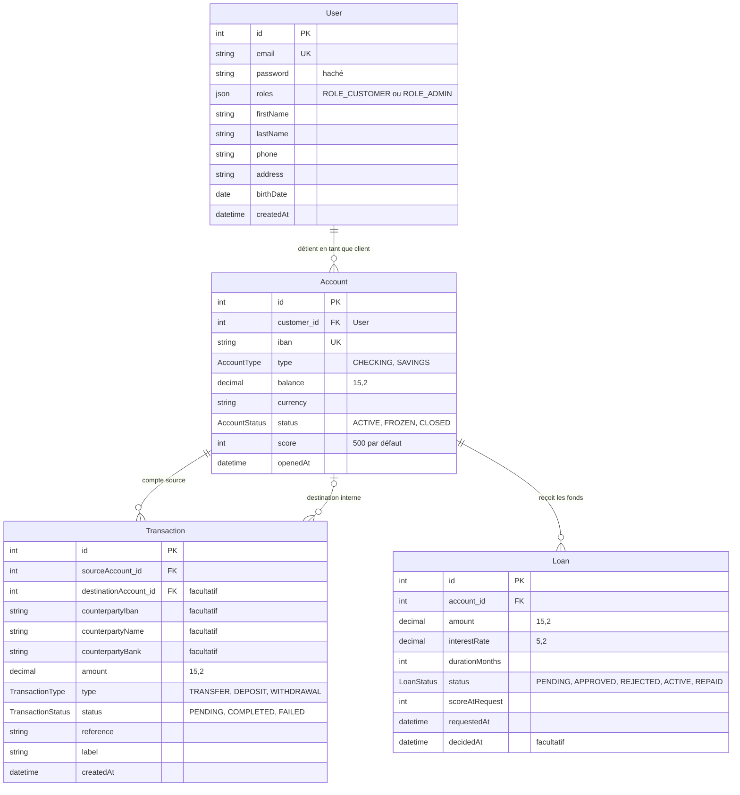

# Banque

Application bancaire sous Symfony, avec Symfony Console, Composer et XAMPP. Un client peut détenir plusieurs comptes, effectuer des dépôts, des retraits et des virements, puis demander un prêt depuis l’un de ses comptes. Le score de ce compte détermine son éligibilité au prêt et peut lui donner accès à un taux réduit ou à d’autres avantages.

## Modèle de données

- **Accès et identité.** `User` regroupe les identifiants de connexion et le profil client. Le rôle détermine l’accès à l’espace client ou au tableau de bord. Les champs d’identité sont obligatoires pour les clients et facultatifs pour les administrateurs. Seul un client peut détenir un compte.
- **Transactions.** `sourceAccount` désigne toujours un compte de la banque. Pour un virement, il faut renseigner exactement un des deux champs, `destinationAccount` en interne ou `counterpartyIban` vers une autre banque. Le nom du bénéficiaire et sa banque peuvent compléter l’IBAN externe. Pour un dépôt ou un retrait, les deux destinations restent vides et l’opération crédite ou débite le compte indiqué.
- **Prêts.** À la demande, `Loan.scoreAtRequest` conserve le score du compte choisi. Ce score reste celui de la demande même si le score du compte évolue. Le même compte reçoit les fonds si le prêt est accordé.
