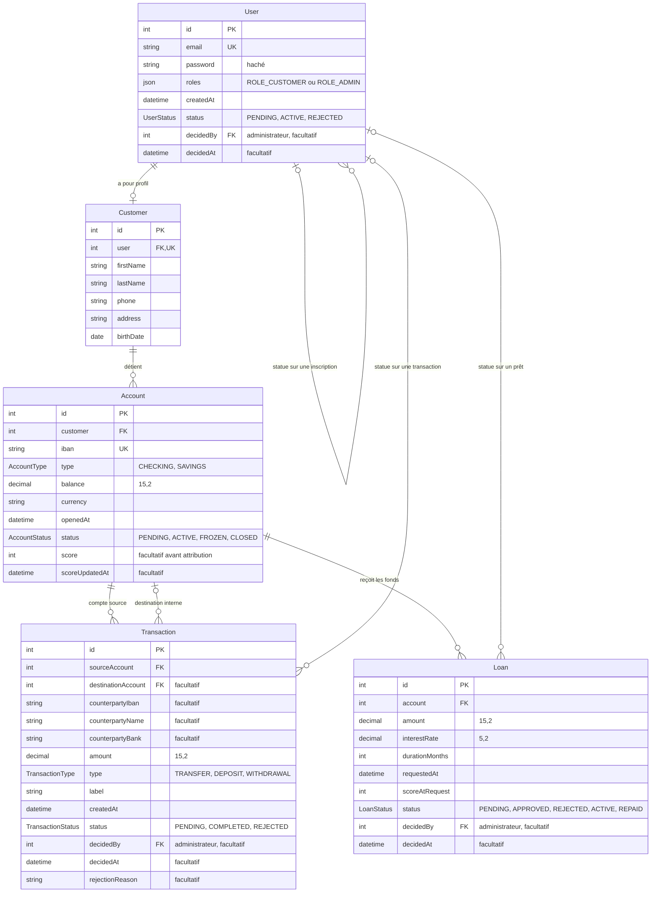

# Banque

Application bancaire sous Symfony, avec Symfony Console, Composer et XAMPP. Un client peut détenir plusieurs comptes, effectuer des dépôts, des retraits et des virements, et demander un prêt. L’administrateur traite les inscriptions, les transactions et les demandes de prêt.

## Modèle de données



- **Inscription.** Un client possède un profil `Customer` lié à son `User`. Un administrateur utilise uniquement `User`. Le `UserChecker` de Symfony autorise la connexion uniquement lorsque `User.status` vaut `ACTIVE`.
- **Comptes et prêts.** Un compte `PENDING` ne peut ni envoyer ni recevoir de fonds, ni servir à demander un prêt. L’administrateur fixe le score de chaque compte. Lors d’une demande, `scoreAtRequest` conserve le score utilisé pour évaluer l’éligibilité et le taux du prêt.
- **Transactions.** Un virement désigne exactement un destinataire par `destinationAccount` en interne ou par `counterpartyIban` vers une autre banque. Un dépôt ou un retrait porte uniquement sur `sourceAccount`. Seule une transaction `COMPLETED` modifie le solde.
- **Décisions.** Pour une inscription, une transaction ou un prêt, `decidedBy` et `decidedAt` indiquent qui a pris la décision et à quelle date. Ces champs restent vides tant que la décision est en attente.

## Initialisation

PHP 8.2, Symfony CLI, Composer et MariaDB 10.4 de XAMPP sont utilisés pour ce projet.

```bash
symfony new banque --version="7.4.*" --webapp --no-git
cd banque
php bin/console make:user User
php bin/console make:entity Customer
php bin/console make:entity Account
php bin/console make:entity Transaction
php bin/console make:entity Loan
```

Dans `make:user`, choisir le stockage Doctrine, l’identifiant `email` et le hachage des mots de passe. Les générateurs créent les classes et les repositories. Les champs, relations et enums du modèle sont ensuite définis dans `src/Entity` et `src/Enum`. La commande suivante génère leurs accesseurs.

```bash
php bin/console make:entity --regenerate App --no-interaction
```

Les fichiers de l’application sont placés à la racine du dépôt. Démarrer MySQL dans XAMPP avant les commandes Doctrine. La connexion locale utilise la base `banque` sur le port 3306. Adapter les identifiants dans `.env.local` si nécessaire.

```dotenv
DATABASE_URL="mysql://root:@127.0.0.1:3306/banque?serverVersion=10.4.32-MariaDB&charset=utf8mb4"
```

```bash
php bin/console doctrine:database:create --if-not-exists
php bin/console make:migration
php bin/console doctrine:migrations:migrate --no-interaction
php bin/console doctrine:schema:validate
```

La première migration crée les cinq tables métier et la table technique de Symfony Messenger. Le score reste vide jusqu’à son attribution par un administrateur. `UserChecker` contrôle le statut de l’utilisateur. Les écrans et le traitement des opérations constituent les prochaines étapes.

## Installation depuis le dépôt

Après le clonage, exécuter les commandes suivantes à la racine, avec MySQL démarré dans XAMPP.

```bash
composer install
php bin/console doctrine:database:create --if-not-exists
php bin/console doctrine:migrations:migrate --no-interaction
symfony server:start
```

## Vérification

```bash
composer validate --strict
php bin/console doctrine:schema:validate
php bin/console lint:container
php bin/console lint:yaml config
```
