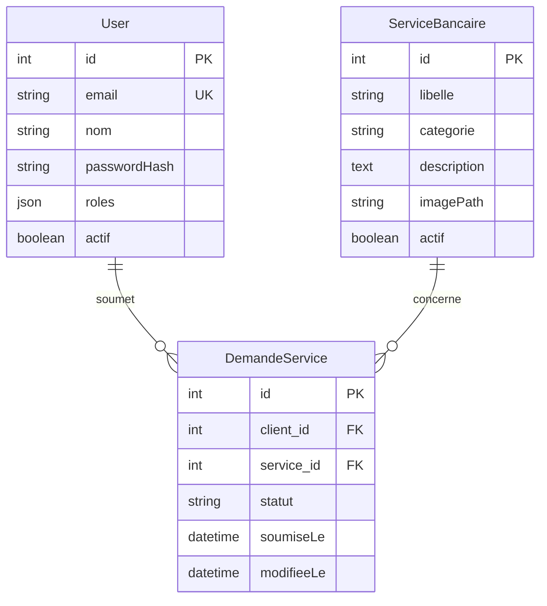

# Symfony_Banque_project

## Portail de services bancaires

Un client cherche un service, par exemple le renouvellement d’une carte, en consulte les conditions et envoie une demande. Il retrouve ensuite son état d’avancement dans son espace personnel. Depuis le tableau de bord, l’administrateur gère le catalogue, traite les demandes et consulte les statistiques.

Le thème **Banque** se réalise en solo. Le cahier des charges demande au moins deux entités avec leurs opérations de création, consultation, modification et suppression (CRUD), en plus de l’utilisateur. Le modèle proposé retient `ServiceBancaire` et `DemandeService`. Chaque demande porte sur un seul service, ce qui permet une confirmation directe depuis sa fiche.

## Entités et relations



- **Client et demandes.** Un client peut s’inscrire avant de faire sa première demande. Chaque demande appartient à un seul client. L’administrateur est aussi un `User`, identifié par le rôle `ROLE_ADMIN`.
- **Service et demandes.** Un service peut figurer au catalogue avant de recevoir une demande. Chaque demande garde le lien vers le service choisi. Dans Doctrine, `DemandeService` porte les deux associations `ManyToOne` obligatoires.
- **Historique.** Un service déjà demandé peut être retiré du catalogue avec `actif = false`. Les clés étrangères bloquent la suppression d’un service ou d’un client encore lié à une demande.
- **Suivi.** Une nouvelle demande reçoit le statut `soumise`. L’administrateur peut l’accepter ou la refuser. Le client peut l’annuler tant qu’elle est soumise. Le tableau de bord compte les demandes par statut et par service à partir des mêmes enregistrements.

## Parcours et responsabilités

| Fonction | Espace client | Tableau de bord administrateur |
| --- | --- | --- |
| Comptes | S’inscrire, se connecter et consulter son profil | Consulter les clients, modifier leur profil et désactiver un accès |
| Catalogue | Rechercher un service actif par libellé ou catégorie et lire sa fiche | Créer, consulter, modifier et supprimer un service inutilisé. Téléverser le visuel obligatoire de chaque service |
| Demandes | Confirmer le service choisi, consulter ses propres demandes et annuler une demande soumise | Créer une demande pour un client, la consulter, modifier son statut et supprimer une saisie erronée |
| Statistiques | | Voir le nombre de demandes par statut et les services les plus demandés |

## Squelette Symfony prévu

Composer gère les dépendances PHP. Symfony Console (`php bin/console`) sert notamment à créer et appliquer les migrations Doctrine. En développement, Apache de XAMPP sert le répertoire `public/` et MariaDB stocke les trois entités.

```text
bin/console                 Commandes Symfony
composer.json               Dépendances et autoload PHP
config/packages/            Configuration de Doctrine et de Symfony Security
migrations/                 Évolution du schéma MariaDB
public/                     Point d’entrée web
  uploads/services/         Visuels du catalogue
src/
  Controller/
    Client/                 Catalogue, profil et demandes personnelles
    Admin/                  Gestion des clients, services, demandes et statistiques
  Entity/                   User, ServiceBancaire, DemandeService
  Repository/               Filtres du catalogue, historique et agrégats
  Form/                     Inscription, service avec visuel et demande
  Security/                 Contrôle de propriété des demandes
templates/
  client/                   Pages Twig du portail
  admin/                    Pages Twig du tableau de bord
```

L’espace personnel exige une connexion et vérifie le propriétaire à chaque accès à une demande. Les routes `/admin` exigent `ROLE_ADMIN`. Les formulaires qui modifient des données utilisent des jetons CSRF, les vues Twig échappent les contenus affichés et les recherches Doctrine utilisent des paramètres liés. Le téléversement vérifie le type et la taille du visuel, puis génère son nom de stockage.

Pour la démonstration sur PC, le parcours de référence va de la création d’un service avec son visuel jusqu’à l’acceptation d’une demande et à son affichage dans les statistiques. Le cahier des charges prévoit des commits Git individuels et recommande une interface responsive ainsi qu’une démonstration en mode production.
