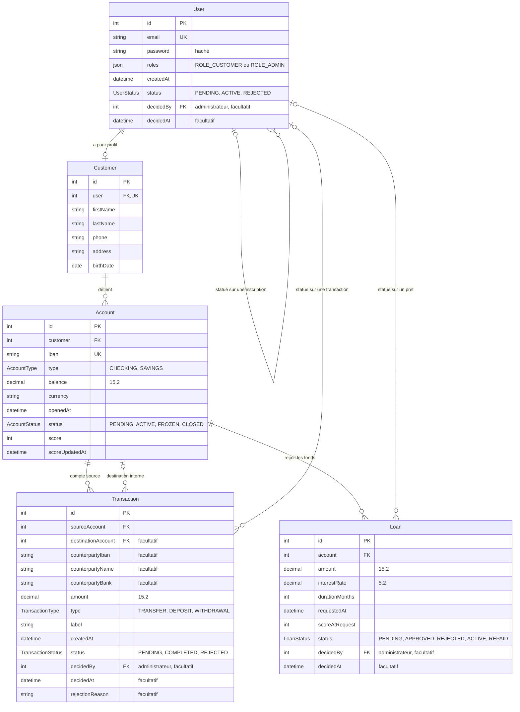

# Banque

Application bancaire sous Symfony, avec Symfony Console, Composer et XAMPP. Un client peut détenir plusieurs comptes, effectuer des dépôts, des retraits et des virements, et demander un prêt. L’administrateur traite les inscriptions, les transactions et les demandes de prêt.

## Modèle de données

- **Inscription.** Un client possède un profil `Customer` lié à son `User`. Un administrateur utilise uniquement `User`. Le `UserChecker` de Symfony autorise la connexion uniquement lorsque `User.status` vaut `ACTIVE`.
- **Comptes et prêts.** Un compte `PENDING` ne peut ni envoyer ni recevoir de fonds, ni servir à demander un prêt. L’administrateur fixe le score de chaque compte. Lors d’une demande, `scoreAtRequest` conserve le score utilisé pour évaluer l’éligibilité et le taux du prêt.
- **Transactions.** Un virement désigne exactement un destinataire par `destinationAccount` en interne ou par `counterpartyIban` vers une autre banque. Un dépôt ou un retrait porte uniquement sur `sourceAccount`. Seule une transaction `COMPLETED` modifie le solde.
- **Décisions.** Pour une inscription, une transaction ou un prêt, `decidedBy` et `decidedAt` indiquent qui a pris la décision et à quelle date. Ces champs restent vides tant que la décision est en attente.
